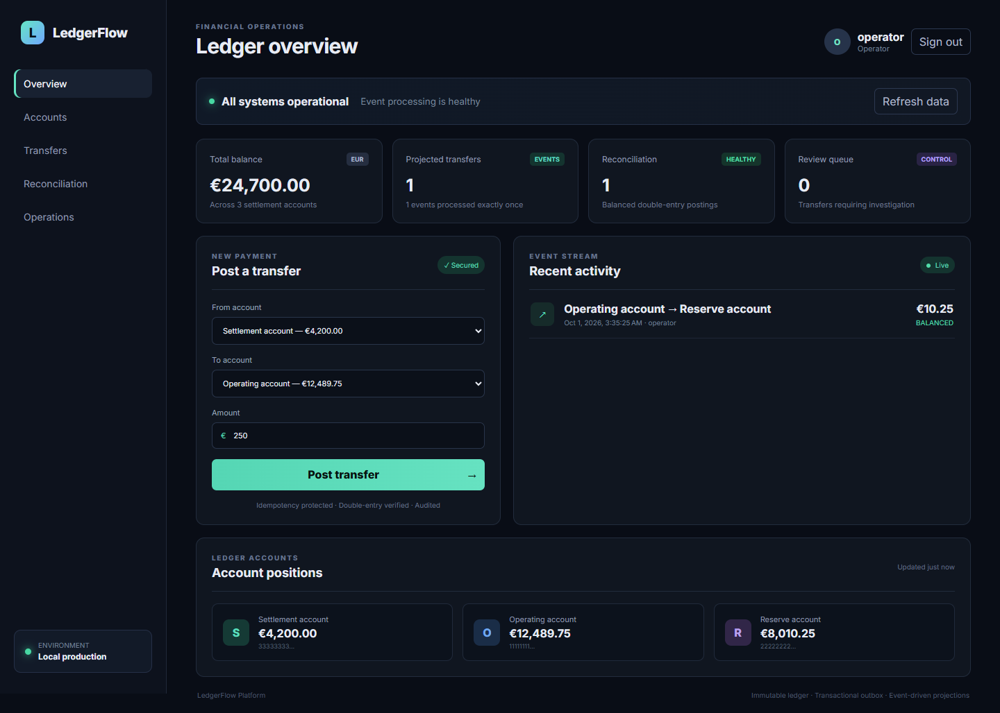
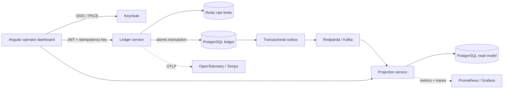

# LedgerFlow

[](https://github.com/MontassarBenMesmia/ledgerflow-platform/actions/workflows/ci.yml)
[](https://github.com/MontassarBenMesmia/ledgerflow-platform/actions/workflows/security.yml)
[](https://adoptium.net/)
[](https://angular.dev/)
[](LICENSE)

A production-minded financial ledger that demonstrates how to move money safely across services: immutable double-entry postings, idempotent commands, transactional outbox delivery, Kafka projections, automated reconciliation, and an observable operator dashboard.



## Why this project exists

A normal CRUD transfer endpoint can lose events, double-charge on retries, or corrupt balances under concurrency. LedgerFlow makes those failure modes explicit and addresses them with database transactions, deterministic locking, idempotency, at-least-once messaging, deduplicated consumers, and an independently reconciled read model.

## System design



| Concern | Implementation |
|---|---|
| Correct balances | One debit + one credit per transfer; property-tested zero-sum invariant |
| Concurrent writes | Pessimistic account locks acquired in stable UUID order plus optimistic versions |
| Client retries | Unique `Idempotency-Key`, rechecked after locks |
| Reliable messaging | Transfer, entries, and outbox event commit in the same database transaction |
| Duplicate events | Consumer inbox (`processed_events`) makes projections idempotent |
| Access control | Keycloak OIDC, PKCE browser login, realm roles, JWT validation |
| Abuse protection | Redis-backed per-user command rate limit |
| Operations | Health probes, Prometheus metrics, OTLP traces, Grafana dashboard |
| Delivery | Docker Compose, Helm, Argo CD, AWS Terraform reference, GitHub Actions |

## Run it locally

Requirements: Docker Desktop with Compose v2 and approximately 3 GB of free memory.

```bash
git clone https://github.com/MontassarBenMesmia/ledgerflow-platform.git
cd ledgerflow-platform
docker compose up --build -d
```

Open **http://localhost** and use the local-only account:

- username: `operator`
- password: `operator123`

Post a transfer from one seeded EUR account to another. The ledger commits the balanced entries and outbox record atomically; within a moment, the Kafka consumer updates the activity feed and reconciliation counters.

Verify the full path—including authentication, transfer creation, retry idempotency, event projection, and reconciliation:

```powershell
pwsh tests/smoke.ps1
```

Stop the environment with `docker compose down`. Add `-v` only when you intentionally want to erase local database state.

## API surface

| Method | Route | Purpose |
|---|---|---|
| `GET` | `/api/ledger/accounts` | Current authoritative account balances |
| `POST` | `/api/ledger/transfers` | Post a transfer; requires `Idempotency-Key` |
| `GET` | `/api/ledger/transfers` | Recent authoritative transfers |
| `GET` | `/api/projection/activity` | Kafka-built activity read model |
| `GET` | `/api/projection/reconciliation` | Processing and balance controls |

The domain event is documented in [AsyncAPI](docs/asyncapi.yaml). Each service also exposes OpenAPI JSON at `/v3/api-docs` and operational endpoints under `/actuator`.

## Engineering verification

```bash
# Backend unit, service, and property tests
mvn verify

# Frontend tests and optimized build
cd frontend
npm ci
npm test -- --watch=false
npm run build

# Declarative platform checks
docker compose config --quiet
helm lint deploy/helm/ledgerflow --set secrets.postgresPassword=local-check
terraform -chdir=infra/terraform init -backend=false
terraform -chdir=infra/terraform validate
```

CI repeats those checks, builds every container, scans source and dependencies with CodeQL and Trivy, and publishes versioned images to GHCR for `v*` tags. Dependabot groups routine dependency updates to keep the signal useful.

## Observability

```bash
docker compose --profile observability up -d
```

Grafana runs at **http://localhost:3000** with provisioned Prometheus and Tempo data sources. The included dashboard tracks request rate, processed events, and projection failures. Both Java services emit traces through the OpenTelemetry collector.

## Deployment paths

- `deploy/helm/ledgerflow` packages the three application workloads with probes, limits, and hardened security contexts.
- `deploy/argocd/application.yaml` defines automated, self-healing GitOps synchronization.
- `infra/terraform` is an intentionally deployable AWS reference for private networking, encrypted RDS PostgreSQL, MSK Serverless, and ElastiCache Serverless. State backend, DNS, certificates, identity, and secret management remain environment-specific by design.

See [architecture decisions](docs/architecture.md), the [operations runbook](docs/operations.md), and the [security policy](SECURITY.md) for the reasoning and production boundaries.

## Repository map

```text
contracts/             shared immutable Kafka event contract
ledger-service/        authoritative ledger, outbox, transfers, rate limiting
projection-service/    idempotent consumer and reconciliation read model
frontend/              authenticated Angular operations dashboard
infra/                  local identity/telemetry and AWS Terraform
deploy/                 Helm package and Argo CD application
tests/                  end-to-end smoke and k6 load scenarios
docs/                   architecture, event contract, and runbook
```

## Scope

LedgerFlow uses simulated funds and is an engineering portfolio project, not a bank or payment processor. Production use would additionally require regulated payment integrations, HSM-backed key management, stronger segregation of duties, immutable audit retention, disaster-recovery exercises, and jurisdiction-specific compliance controls.

Licensed under the [MIT License](LICENSE).
